# 🏙️ OCMS — Online Complaint Management System

> A city-service grievance portal. Citizens report civic issues, staff route and resolve them, and administrators manage the whole pipeline — every ticket tracked against an SLA deadline from the moment it is filed.

**Stack:** Node.js · Express 5 · MongoDB (Mongoose 8) · EJS · No build step, no framework

---

## 📸 Screenshots

| Citizen Portal | Officer Queue | Admin Reports |
|:---:|:---:|:---:|
| 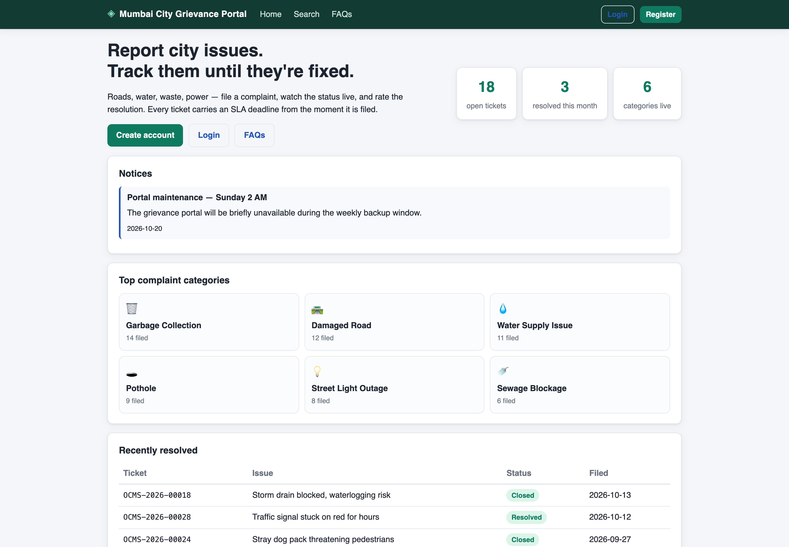 | 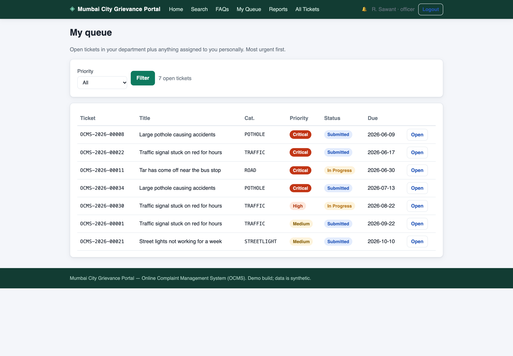 | 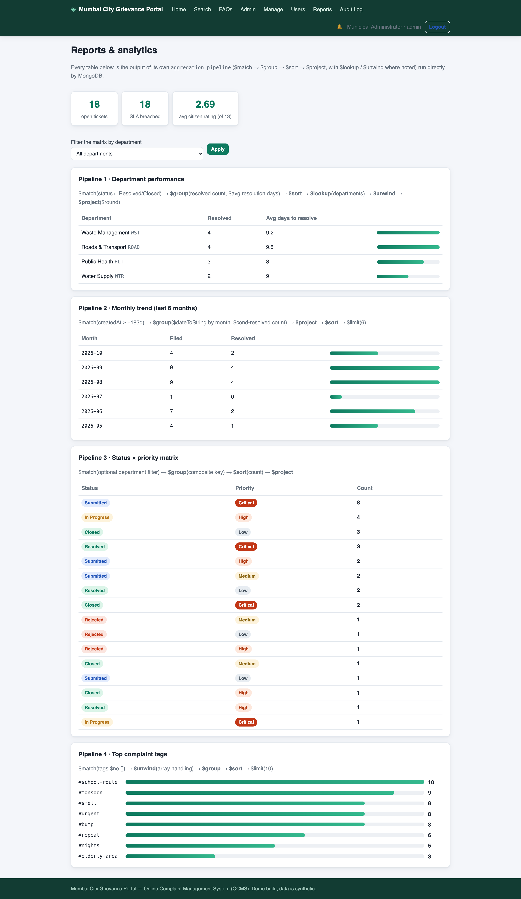 |

<details>
<summary><strong>More screenshots (19 pages)</strong></summary>

| | |
|---|---|
| 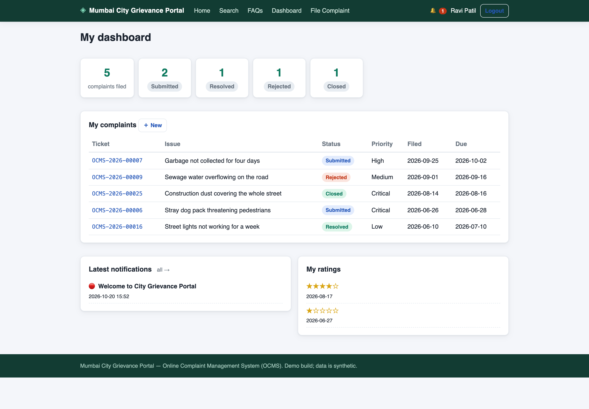 | 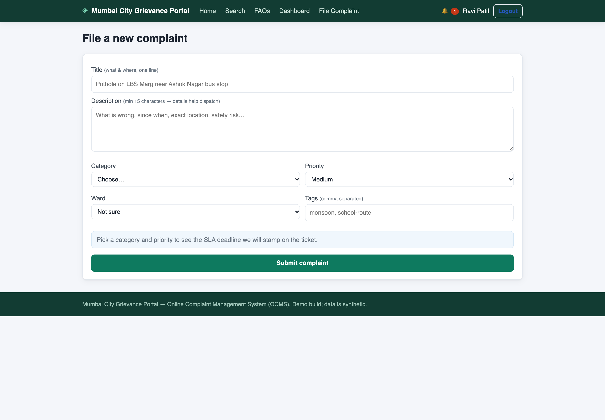 |
| 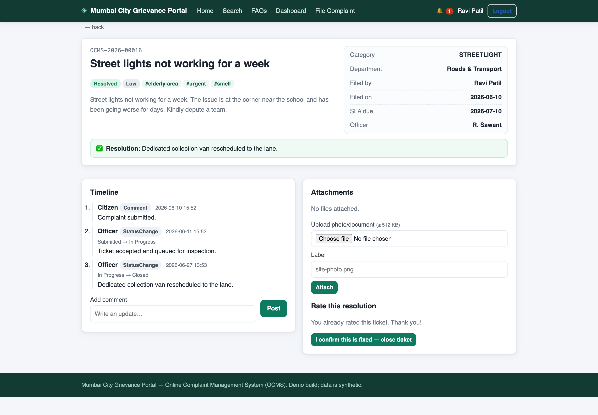 | 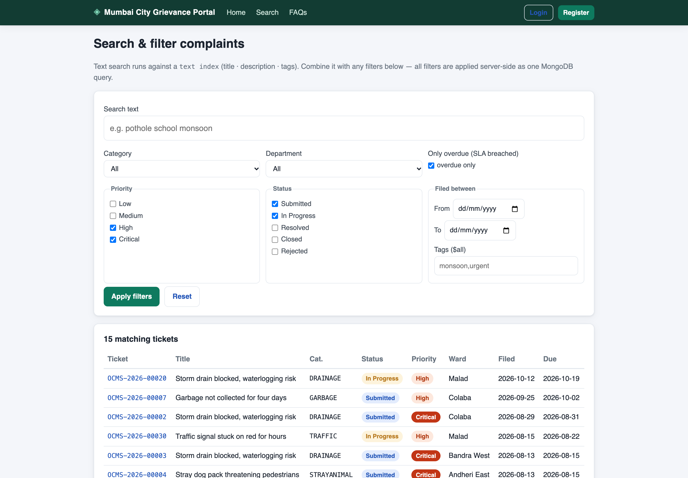 |
| 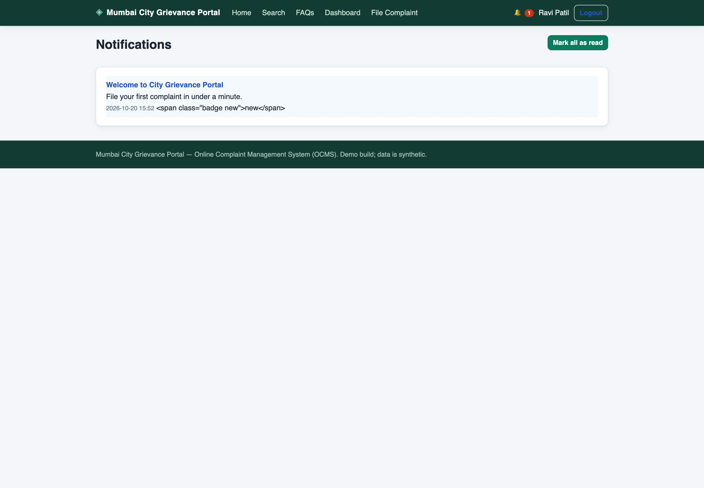 |  |
| 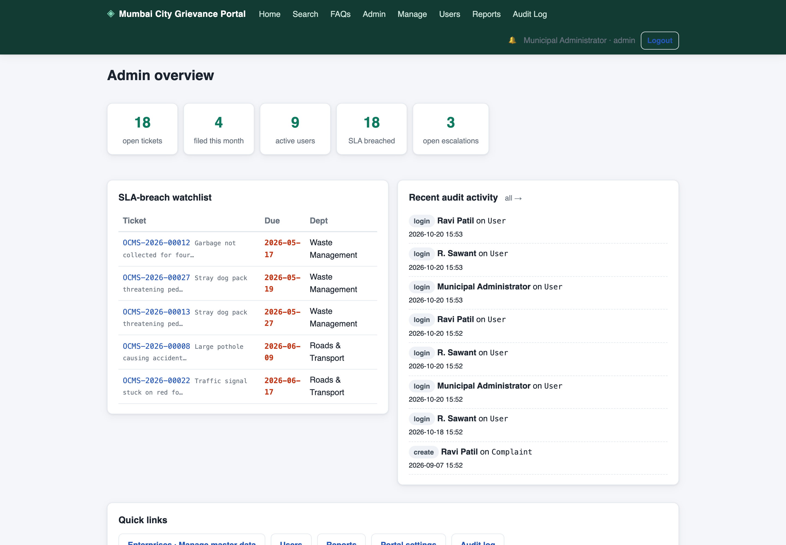 | 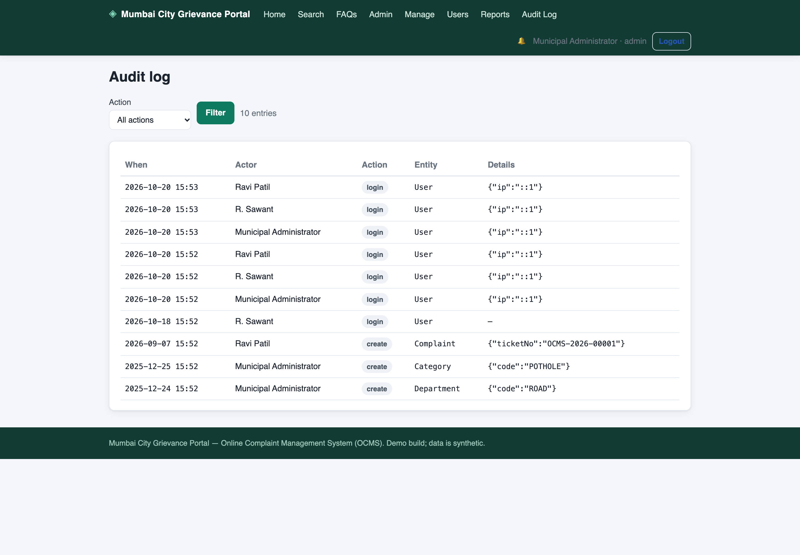 |

</details>

---

## ✨ Features

### 👤 Citizens
- Register, log in, and manage a profile with address details
- File complaints across 6+ categories (roads, water, waste, power…) with priority and photo/attachment upload (≤ 512 KB)
- Track each ticket live: status timeline, comments, and due date
- Comment on ongoing work, rate the resolution (★ 1–5), and close the ticket
- In-app notifications for status changes; dashboard with personal status counts

### 🧑‍💼 Officers
- Role-scoped queue filtered by department or direct assignment
- Comment, resolve, reject, and escalate (priority bump) tickets
- Open-case counters per officer for workload visibility

### 🛡️ Admins
- Full CRUD on master data: departments, wards, categories, SLA rules, FAQs, announcements
- Manage users and assignments; reassign tickets across officers
- SLA-breach watchlist and escalation monitor
- Reports dashboard from live MongoDB aggregation pipelines (see charts below)
- Complete audit log of every actor/action/entity mutation

### 🌐 Public
- Landing page with live KPI cards, notices, and top categories
- Full-text search across complaints (`$text` + `$meta` relevance ranking)
- Public FAQ page

---

## 📊 Reports — Aggregation Pipelines

| Pipeline | Stages |
|---|---|
| ① Department performance | `$match` → `$group` (avg resolution days) → `$sort` → `$lookup` → `$unwind` → `$project` |
| ② Monthly trend | `$match` (date range) → `$group` (`$dateToString`) → `$project` → `$sort` → `$limit` |
| ③ Status × priority matrix | `$match` → `$group` (composite key) → `$sort` → `$project` |
| ④ Top complaint tags | `$unwind` → `$group` → `$sort` → `$limit` |
| ⑤ Average citizen rating | `$group` aggregate |

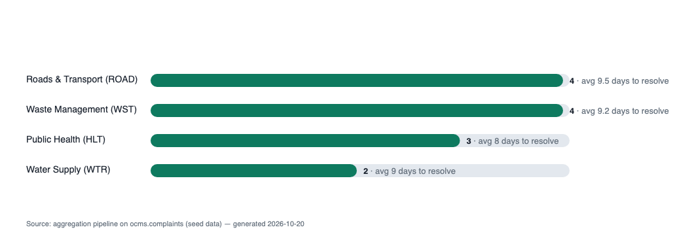

---

## 🗄️ Data Model — 20 Collections

<details>
<summary><strong>Expand schema</strong></summary>

| # | Collection | Purpose |
|---|-----------|---------|
| 1 | `users` | accounts (citizen / officer / admin), scrypt password hashes |
| 2 | `sessions` | login sessions, TTL auto-expiry |
| 3 | `citizens` | profiles with **embedded address document** |
| 4 | `officers` | staff profiles → department linkage, open-case counters |
| 5 | `departments` | departments + category codes they handle |
| 6 | `wards` | city zones |
| 7 | `categories` | complaint categories, `totalFiled` counters |
| 8 | `slarules` | resolution window per category × priority (unique compound index) |
| 9 | `complaints` | main document — tags array, embedded resolution doc, `dueAt` |
| 10 | `updates` | ticket timeline comments / status changes |
| 11 | `attachments` | inline base64 files (≤ 512 KB) |
| 12 | `assignments` | assignment / reassignment history |
| 13 | `escalations` | priority bump records |
| 14 | `feedbacks` | citizen ratings of resolutions |
| 15 | `notifications` | per-user inbox |
| 16 | `faqs` | public FAQ entries |
| 17 | `announcements` | audience-scoped portal notices |
| 18 | `auditlogs` | actor/action/entity for every mutation |
| 19 | `settings` | key/value app settings |
| 20 | `counters` | atomic ticket-number generator (`$findOneAndUpdate` `$inc`) |

**Indexes:** text index (`title`, `description`, `tags`), compound `{status, createdAt}`, unique `{categoryCode, priority}` on SLA rules, TTL on session expiry, unique email/ticket/token, per-model FK auto-indexes — all rebuilt by `seed.js` / `syncIndexes()` on boot.

</details>

---

## 🚀 Quick Start

```bash
# 1. MongoDB — either local or cloud (Atlas)
mongod --dbpath .mongodbdata --port 27017 &          # local
# or point .env (copy .env.example) at your Atlas URI

# 2. Install + seed + start
npm install
npm run seed        # wipes & reseeds demo data (34 complaints, 6 months)
npm start           # → http://localhost:3000

# 3. Verify everything end-to-end
npm run smoke       # 14-step HTTP test, exits non-zero on failure
```

### 🔑 Demo Logins

| Role | Login | Password |
|---|---|---|
| **Admin** | `admin@ocms.test` | `Admin@12345` |
| **Officer** | `road@ocms.test` · `water@ocms.test` · `waste@ocms.test` · `power@ocms.test` | `Officer@123` |
| **Citizen** | `ravi@proton.test` · `sneha@proton.test` · `iqbal@proton.test` · `meera@proton.test` · `deelip@proton.test` | `Citizen@123` |

> ⚠️ Demo passwords are seed data only. `seed.js` drops the target database — never run it against a real one.

---

## 🧪 Testing

| Script | What it does |
|---|---|
| `npm run smoke` | 14-step end-to-end HTTP test (register → file → resolve → rate → reports → role guards) |
| `npm run spot` | Admin-flow spot checks (assign / escalate / settings / wards / SLA) |
| `npm run shots` | Captures all 19 demo pages headlessly into `screenshots/` |
| `npm run charts` | Renders report charts (SVG + PNG) from live aggregation pipelines |

---

## 📁 Project Structure

```
ocms/
├── server.js        # express bootstrap, cookie parsing, DB connect + syncIndexes
├── routes.js        # every route ($-features tagged with ★ comments)
├── auth.js          # scrypt hashing, session middleware, roles, audit/notify helpers
├── models.js        # the 20 Mongoose schemas + all indexes
├── seed.js          # wipes & reseeds realistic demo data
├── smoke.js         # end-to-end test (exits non-zero on failure)
├── spotcheck.js     # admin-flow checks
├── screenshot.js    # headless captures of all 19 pages
├── report/          # assignment deliverable: charts + REPORT.md
├── views/           # 17 EJS pages + 2 partials
├── public/style.css # single stylesheet, no framework
└── docs/            # architecture, security, product, design docs
```

---

## 🔒 Security

- **scrypt** password hashing with timing-safe comparison
- httpOnly sameSite cookies; sessions stored server-side with TTL expiry
- Role guards on every protected route (verified by smoke test #14)

*Deliberate demo-scope simplifications:* no CSRF tokens or rate limiting (fine for coursework — add before any real deployment), attachments capped at 512 KB stored inline in MongoDB.

---

## 📄 License

Built as an academic full-stack project. Free to reuse with attribution.
