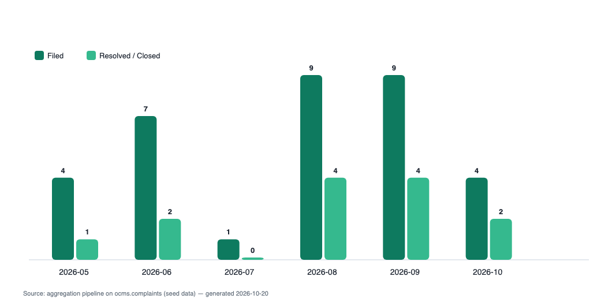
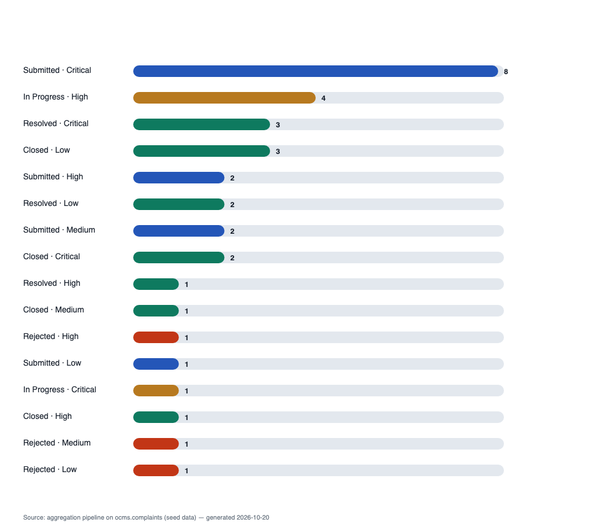
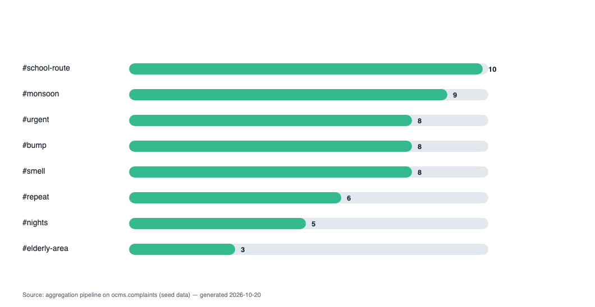

# Online Complaint Management System (OCMS)

**Project Report — MongoDB-based Grievance Portal**

| | |
|---|---|
| Project | Online Complaint Management System (OCMS) |
| Stack | Node.js · Express 5 · Mongoose 8 · EJS · MongoDB 8.3 |
| Source | `ocms/` (this folder) — server-rendered, no build step, 3 npm dependencies |
| Captures | `../screenshots/` (19 page screenshots) · `charts/` (4 generated graphs) |

---

## 1 · Introduction

OCMS lets citizens register and file city-service complaints (roads, water, waste, power,
health…). Every ticket gets an SLA deadline derived from a `sla_rules` collection
(category × priority → max days). Staff resolve tickets step-by-step through a public
timeline; citizens rate the resolution. Administrators manage all master data and read
analytics produced by MongoDB aggregation pipelines.

Everything below is *implemented and verified* — screenshots and chart images in this
folder were generated from the running system and its live database.

## 2 · Architecture

```
Browser ──HTTP──▶ Express 5 server (server.js)
                    ├── auth.js      scrypt passwords · Mongo-backed sessions · roles
                    ├── routes.js    all pages/actions (search, reports, staff, admin)
                    ├── models.js    20 Mongoose collections + all indexes
                    └── views/*.ejs  17 EJS pages
                          │
                          ▼
                    MongoDB 8.3 (db "ocms", 20 collections) ◀── Compass
```

## 3 · The 20 MongoDB collections

| # | Collection | Purpose |
|---|-----------|---------|
| 1 | `users` | accounts (citizen/officer/admin), scrypt password hashes, stats |
| 2 | `sessions` | login sessions, **TTL** auto-expiry |
| 3 | `citizens` | citizen profiles with **embedded address document** |
| 4 | `officers` | staff profiles → department link, open-case counters |
| 5 | `departments` | city departments + category codes they handle |
| 6 | `wards` | city zones |
| 7 | `categories` | complaint categories, `totalFiled` counters |
| 8 | `slarules` | resolution window per category × priority (**compound unique index**) |
| 9 | `complaints` | main document: **tags array**, **embedded `resolution` doc**, dueAt |
| 10 | `updates` | timeline comments / status changes |
| 11 | `attachments` | uploaded photos stored in MongoDB (base64 ≤ 512 KB) |
| 12 | `assignments` | assignment/reassignment history |
| 13 | `escalations` | priority escalation records |
| 14 | `feedbacks` | citizen ratings (unique per ticket per user) |
| 15 | `notifications` | per-user inbox |
| 16 | `faqs` | public FAQ |
| 17 | `announcements` | portal notices (audience-scoped) |
| 18 | `auditlogs` | every mutation logged (actor, action, entity) |
| 19 | `settings` | key/value store (org name, portal flags) |
| 20 | `counters` | atomic ticket-number generator |

## 4 · Requirement → implementation map

| Assignment requirement | Where in code |
|---|---|
| CRUD operations | complaints/cat./dept./ward/FAQ/announcement/user/settings (see §7) |
| Logical filtering — `$or`, `$and` | login email-or-phone; officer queue; search "overdue switch"; admin breach KPI |
| Comparison filtering — `$in`, `$gte`, `$lte`, `$lt`, `$ne`, `$exists` | search filters, SLA breach (`dueAt < now`), date ranges |
| Projection + limit | every list uses `.select(...)` + `.limit(...)`; search paginates with skip/limit |
| Array handling | `tags` via `$addToSet` / `$pull` / `$all`; `$unwind`+`$group` tag pipeline |
| Document handling | embedded `address` & `resolution` sub-documents; `$lookup` + `$unwind`; `$inc`; `findOneAndUpdate` upserts |
| Aggregation pipelines `≥3` | 5 pipelines — §5 (all `$match → $group → $sort → $project`) |
| Indexes (≥1) | 8+ — §6.4 (text, compound, unique, TTL) |
| Text search | `$text: { $search }` + `$meta` score ranking (§6.2) |
| Search/filter/report section | `/search` (7-way filters), `/reports` (5 pipelines + KPIs), `/audit` |

## 5 · Aggregation pipelines (the analytics core)

All five live in `routes.js → reports()` and run entirely inside MongoDB.

### 5.1 Department performance — `$match → $group → $sort → $lookup → $unwind → $project`

```js
const deptPerformance = await M.Complaint.aggregate([
  { $match: { status: { $in: ['Resolved', 'Closed'] }, resolvedAt: { $exists: true, $ne: null } } },
  { $group: {
      _id: '$departmentId',
      resolved: { $sum: 1 },
      avgDays: { $avg: { $divide: [{ $subtract: ['$resolvedAt', '$createdAt'] }, 86400000] } }
  } },
  { $sort: { resolved: -1 } },
  { $lookup: { from: 'departments', localField: '_id', foreignField: '_id', as: 'dept' } }, // document join
  { $unwind: { path: '$dept', preserveNullAndEmptyArrays: true } },
  { $project: { _id: 0, name: '$dept.name', code: '$dept.code', resolved: 1, avgDays: { $round: ['$avgDays', 1] } } }
]);
```

### 5.2 Monthly trend — `$match(range) → $group($dateToString, $cond) → $project → $sort → $limit`

```js
const sixMonths = new Date(now.getTime() - 183 * 86400000);
const monthlyTrend = await M.Complaint.aggregate([
  { $match: { createdAt: { $gte: sixMonths } } },
  { $group: {
      _id: { ym: { $dateToString: { format: '%Y-%m', date: '$createdAt' } } },
      filed:    { $sum: 1 },
      resolved: { $sum: { $cond: [{ $in: ['$status', ['Resolved', 'Closed']] }, 1, 0] } }
  } },
  { $project: { _id: 0, month: '$_id.ym', filed: 1, resolved: 1 } },
  { $sort: { month: 1 } },
  { $limit: 6 }
]);
```

### 5.3 Status × priority matrix — `$match(optional) → $group(composite key) → $sort → $project`

```js
const matrixPipe = [];
if (deptFilter) matrixPipe.push({ $match: { departmentId: deptFilter } });
matrixPipe.push(
  { $group: { _id: { status: '$status', priority: '$priority' }, count: { $sum: 1 } } },
  { $sort: { count: -1 } },
  { $project: { _id: 0, status: '$_id.status', priority: '$_id.priority', count: 1 } }
);
const statusMatrix = await M.Complaint.aggregate(matrixPipe);
```

### 5.4 Top complaint tags — `$unwind → $group → $sort → $limit` (array handling)

```js
const topTags = await M.Complaint.aggregate([
  { $match: { tags: { $exists: true, $ne: [] } } },
  { $unwind: '$tags' },                          // array handling inside a pipeline
  { $group: { _id: '$tags', count: { $sum: 1 } } },
  { $sort: { count: -1 } },
  { $limit: 10 },
  { $project: { _id: 0, tag: '$_id', count: 1 } }
]);
```

### 5.5 Citizen satisfaction — `$group($avg) → $project($round)`

```js
M.Feedback.aggregate([
  { $group: { _id: null, avg: { $avg: '$rating' }, n: { $sum: 1 } } },
  { $project: { _id: 0, avg: { $round: ['$avg', 2] }, n: 1 } }
])
```

## 6 · Other important code

### 6.1 Atomic ticket numbering — `findOneAndUpdate` + `$inc` (models.js)

```js
async function nextTicketNo() {
  const c = await Counter.findOneAndUpdate(
    { key: 'complaint' },
    { $inc: { value: 1 } },
    { new: true, upsert: true }
  );
  return `OCMS-${year}-${String(c.value).padStart(5, '0')}`;   // OCMS-2026-00001
}
```
Two officers creating tickets at the same instant can never mint the same number —
the counter increments as an atomic document update.

### 6.2 Text search + relevance ranking (routes.js `search()`)

```js
if (q) filter.$text = { $search: q };                            // ★ text-index search
// later:
M.Complaint.find(filter, { score: { $meta: 'textScore' } })      // ★ relevance
  .sort({ score: { $meta: 'textScore' } })
```
Powers by the text index `title_text_description_text_tags_text`.

### 6.3 Seven-way filter builder (routes.js `search()`)

```js
if (q)          filter.$text = { $search: q };
if (req.query.category) filter.categoryCode = clean(req.query.category);
if (req.query.priority) filter.priority = { $in: [].concat(req.query.priority) };   // ★ $in
if (req.query.status)   filter.status   = { $in: [].concat(req.query.status) };     // ★ $in
if (req.query.tags)     filter.tags = { $all: tags.split(',').map(clean) };         // ★ $all
if (from || to)  filter.createdAt = { $gte: new Date(from), $lte: new Date(`${to}T23:59:59Z`) };
if (req.query.due === '1')
  filter.$and = [{ status: { $in: openStatuses } }, { dueAt: { $lt: new Date() } }]; // ★ $and
```

### 6.4 Indexes (models.js)

```js
complaintSchema.index({ title: 'text', description: 'text', tags: 'text' });  // text index → /search
complaintSchema.index({ status: 1, createdAt: -1 });                          // compound
complaintSchema.index({ categoryCode: 1, status: 1 });                        // compound
slaRuleSchema.index({ categoryCode: 1, priority: 1 }, { unique: true });      // unique compound → upsert key
sessionSchema.index({ expiresAt: 1 }, { expireAfterSeconds: 0 });             // TTL — Mongo deletes expired sessions
usersSchema: email unique · feedback: {complaintId, userId} unique · many FK single-field indexes
```

### 6.5 Tag array operators — `$addToSet` / `$pull` (routes.js)

```js
if (add) await M.Complaint.updateOne({ _id }, { $addToSet: { tags: add.toLowerCase() } }); // adds, no dupes
if (rm)  await M.Complaint.updateOne({ _id }, { $pull:   { tags: rm.toLowerCase() } });    // removes
```

### 6.6 Passwords + sessions (auth.js)

```js
// register
user.passwordHash = crypto.scryptSync(password, salt = crypto.randomBytes(16).toString('hex'), 64).toString('hex');
// login (timing-safe compare, constant time)
const a = Buffer.from(hash, 'hex'), b = Buffer.from(user.passwordHash, 'hex');
ok = crypto.timingSafeEqual(a, b);
// session = httpOnly sameSite cookie "ocms_sid" → random 48-byte token stored in `sessions`
```

### 6.7 SLA deadline & escalation (routes.js)

```js
// on create: dueAt = createdAt + rule.maxDays   (SlaRule.findOne({categoryCode, priority}))
// admin escalation: priority Low→…→Critical, rank map {"Low":1,"Medium":2,"High":3,"Critical":4}
const priorityRank = { Low: 1, Medium: 2, High: 3, Critical: 4 }[newPriority];
await M.Complaint.updateOne({ _id }, { $set: { priority: newPriority, priorityRank } });
```

## 7 · Charts (generated from live pipeline output)

Every chart below is rendered by `report/charts.js`, which runs the exact same
aggregations as the `/reports` page and converts the results into bar charts.

### 7.1 Complaints filed vs resolved — last 6 months (Pipeline 5.2)



Reading: filing peaked in Aug–Sep 2026 (9 tickets each); July dipped to 1; resolution
throughput tracked filing in Aug–Sep (4/4) but lagged in Jun and Oct — the gap between
the green pairs is open work still on the books.

### 7.2 Resolved tickets per department (Pipeline 5.1)


Reading: **Waste Management** and **Roads & Transport** tie for most resolved (4), while
**Public Health** is the fastest (avg 8.0 days). Averages sit at 8–9.5 days for every
department — the same story the admin SLA-breach watchlist shows (18 open tickets are
past due), which is what the escalation workflow (§6.7) is for.

### 7.3 Status × priority distribution (Pipeline 5.3)



Reading: the largest single block is *Submitted · Critical* (8) — critical tickets filed
recently that still await first assignment; *In Progress · High* (4) is the actively
worked queue. Rejected tickets appear as single cells (duplicates/off-topic), while
resolutions spread across Resolved/Closed rows as departments clear their backlogs.

### 7.4 Most-used complaint tags (Pipeline 5.4)



Reading: `#school-route`, `#monsoon`, `#urgent` dominate — the same tokens the
text-search index uses (§6.2), so searching "school monsoon" lists the municipalities'
hottest recurring problems.

### 7.5 Portal KPIs at capture time (charts/kpi.json)

| KPI | Value | Pipeline |
|---|---|---|
| Open tickets | 18 | `countDocuments(status ∈ Submitted/In-Progress)` |
| SLA breached (overdue open) | 18 | `dueAt < now` comparison |
| Avg citizen rating | 2.69 (13 ratings) | `$avg` over `feedbacks` |

## 8 · System evidence (screenshots — `../screenshots/`)

| File | Page |
|---|---|
| 01–06 | Home, Login, Register, FAQs, Text search "pothole", Combo filters |
| 07–11 | Citizen dashboard, File complaint, Ticket detail (full lifecycle), Notifications, Profile |
| 12 | Citizen blocked from `/admin` → **403 role guard** |
| 13 | Officer queue (urgent-first sorting) |
| 14–19 | Admin overview, Master-data CRUD (full-page), Users, **Reports pipelines** (full-page), Audit log, Settings |

## 9 · Testing

`node smoke.js` runs the whole flow over HTTP against the seeded database — **14/14 PASS**:

1. home renders → 2. register → 3. file complaint → 4. comment → 5. attachment upload →
6. officer login+queue → 7. officer resolve → 8. citizen rate+close → 9. admin pages →
10. reports return pipeline data → 11. text search + filters →
12. unique-index duplicate guard + guarded delete → 13. notifications →
14. role guards (403/redirect/404).

`node spotcheck.js` additionally exercises admin assign / escalate / SLA upsert /
ward CRUD / settings upsert — all green.

## 10 · How to run

### 10.1 All demo accounts (IDs and passwords)

Admin, all officers and all citizens — the complete user list in the seeded database:

| # | Name | Role | Login ID (email) | Password | Dept / notes |
|---|------|------|------------------|----------|--------------|
| 1 | Municipal Administrator | admin | `admin@ocms.test` | `Admin@12345` | full control of the portal |
| 2 | R. Sawant | officer | `road@ocms.test` | `Officer@123` | Roads & Transport (ROAD) |
| 3 | K. Deshmukh | officer | `water@ocms.test` | `Officer@123` | Water Supply (WTR) |
| 4 | A. Shaikh | officer | `waste@ocms.test` | `Officer@123` | Waste Management (WST) |
| 5 | R. Fernandes | officer | `power@ocms.test` | `Officer@123` | Electricity (ELC) |
| 6 | Ravi Patil | citizen | `ravi@proton.test` | `Citizen@123` | Colaba ward |
| 7 | Sneha Rao | citizen | `sneha@proton.test` | `Citizen@123` | Bandra West ward |
| 8 | Iqbal Khan | citizen | `iqbal@proton.test` | `Citizen@123` | Andheri East ward |
| 9 | Meera Joshi | citizen | `meera@proton.test` | `Citizen@123` | Dadar ward |
| 10 | D. Fernandes | citizen | `deelip@proton.test` | `Citizen@123` | Malad ward |

(new registrations during the demo will create additional accounts too — set your own
password on the Register page; passwords are stored as scrypt hashes in `users.passwordHash`)

*Seed-only credentials — a real deployment must rotate them.*

### 10.2 Commands

```bash
# 1. MongoDB on 127.0.0.1:27017 (this project keeps its own instance in .mongodbdata/)
mongod --dbpath ".mongodbdata" --port 27017 &

# 2. app
npm install
npm run seed        # reseeds demo data (34 tickets, 6 months of history)
npm start           # http://localhost:3000

# 3. checks
npm run smoke       # 14-step e2e test
npm run shots       # regenerate ../screenshots
npm run charts      # regenerate report/charts   (run as: node report/charts.js)
```

**Demo logins** — admin@ocms.test / `Admin@12345` · road@ocms.test (also water/waste/power@ocms.test) / `Officer@123` · ravi@proton.test (+4 citizens) / `Citizen@123`
*(seed-only demo credentials)*

## 11 · Conclusion & scope

OCMS demonstrates the full MongoDB feature set required by the syllabus — 20 collections,
CRUD, logical/comparison operators, projection with limits, array & document operations,
five production aggregation pipelines, eight-plus indexes including text/TTL/compound
— wrapped in a working three-role web portal with access control, SLA management
and an audit trail.

**Deliberate scope limits (documented simplifications):** attachments inline ≤512 KB
instead of GridFS; no CSRF tokens or rate-limiting (assignment scope); seed passwords are
hardcoded demo values. Each has a marked upgrade path in the code comments.

---

### Appendix · files in this folder

```
report/
├── REPORT.md            ← this document
├── charts.js            ← chart generator (runs the pipelines, renders SVG+PNG)
├── charts/              ← 01-department-performance, 02-monthly-trend,
│                          03-status-priority-matrix, 04-top-tags  (.svg + .png)
│                          + kpi.json (raw pipeline output at capture time)
└── code/                ← exact copies of the app source
    ├── server.js        express bootstrap, cookies, DB connect + syncIndexes
    ├── models.js        all 20 schemas + indexes
    ├── routes.js        every route (dashboard/search/staff/admin/CRUD)
    ├── auth.js          scrypt, sessions, roles, audit/notify
    ├── seed.js          deterministic demo data seeder
    └── smoke.js         14-step end-to-end test
```
